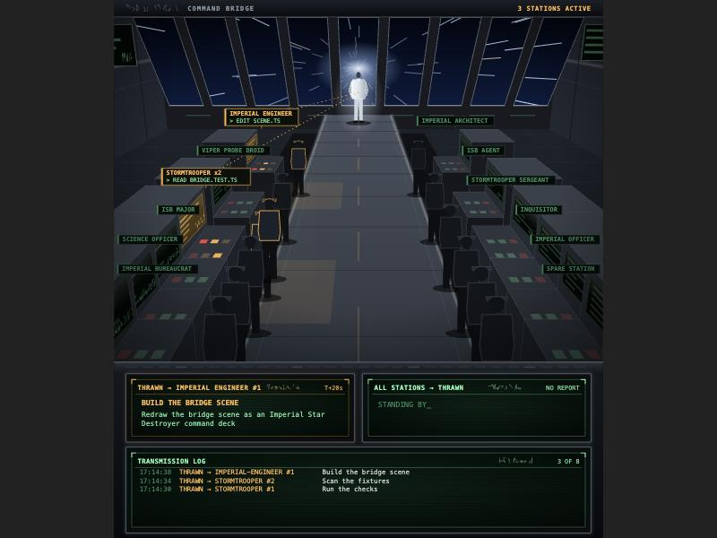
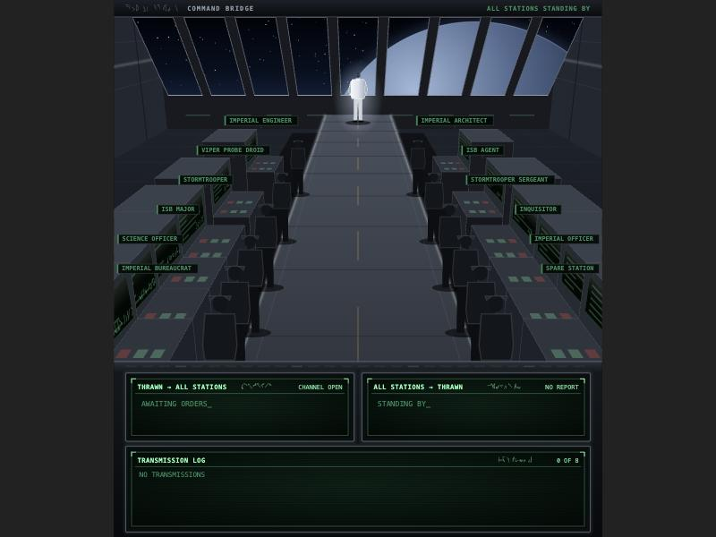
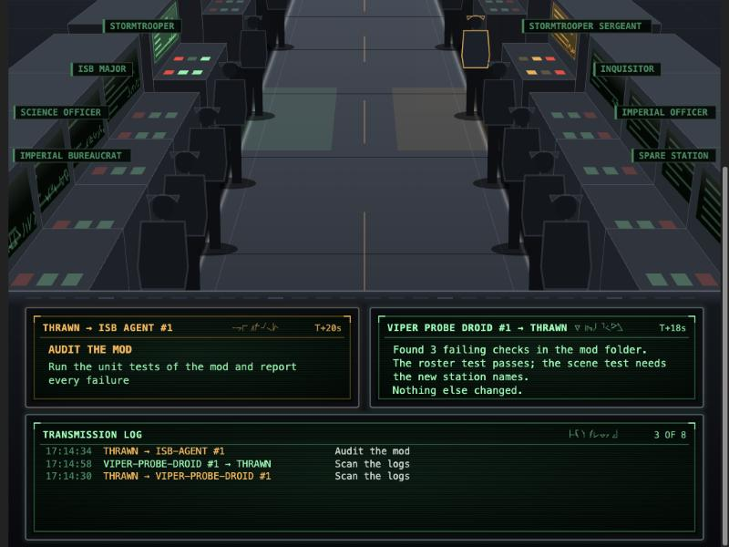
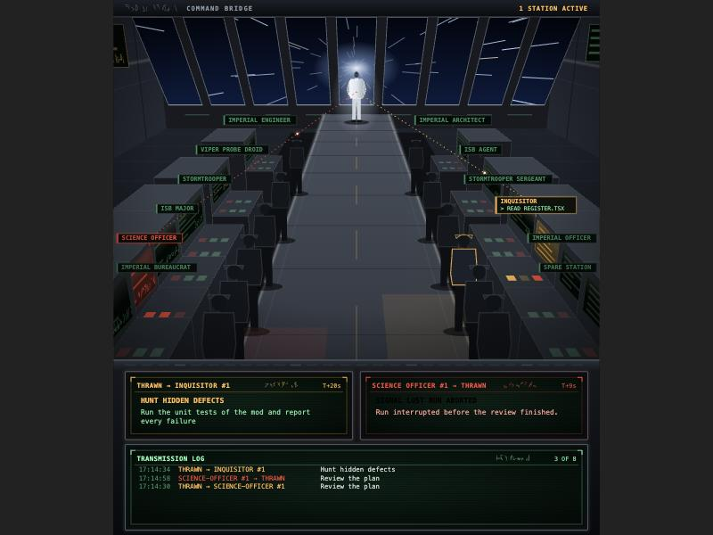
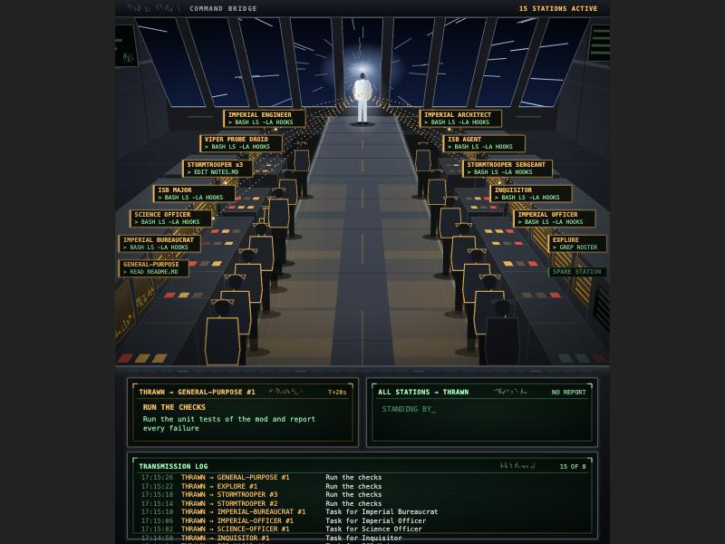

# imperial-bridge

A Claude Code mod that opens a live pane in the Claude desktop app: the command bridge of an Imperial-class Star Destroyer. Grand Admiral Thrawn stands at the viewport end of the raised walkway; the imperial agents (subagents) work at consoles in the two crew pits.

- Stations: each agent type has a console labelled with its rank (Imperial Engineer, Viper Probe Droid, ISB Agent, Imperial Architect, Science Officer, Inquisitor, Stormtrooper, Stormtrooper Sergeant, Imperial Officer, ISB Major, Imperial Bureaucrat). Any other subagent type takes the spare station and is labelled with its own name.
- Order: on spawn, the station lights up, a dotted link runs from Thrawn to it, and the console readout shows `THRAWN → <RANK>` with the brief's `description` and the first line of its `prompt`. While any agent works, the viewport shows hyperspace; otherwise a planet.
- Work: the console flickers and its plate shows the current tool (name plus the first 40 characters of a Bash command or a file name, cut to 30 on the plate). Each running instance of a type is a lit operator at its station, and the plate shows `x2`, `x3`.
- Report: the link runs back to Thrawn for 3 seconds and the readout shows `<RANK> → THRAWN` with the first lines of the report and the duration. Aborted runs show in alert red with `SIGNAL LOST`.
- Log: the console below the viewport lists the last 8 transmissions, newest first.

The scene is one vector SVG (no image, no font, no URL) drawn in perspective from a camera model (`hooks/projection.ts`). The latest drawing is about 110 KB at most, under the 131,072 character limit of the `Svg` element.

## Screenshots

Working, with a hyperspace viewport and the order and report consoles:



Idle, waiting for orders:



Report received from a station:



Aborted run, in alert red:



Every station busy:



## Install

From GitHub:

```
claude plugin marketplace add olivierapex/imperial-bridge
claude plugin install imperial-bridge@imperial-bridge
```

## Load it

For this session, the mod folder is linked at `~/.claude/dev-mods/<session id>/imperial-bridge`. Claude Code asks once to enable hot reloading; accept it.

From a local clone:

```
claude plugin marketplace add <path to the clone>
claude plugin install imperial-bridge@imperial-bridge
```

Open the pane with `/bridge`. It also opens on the first agent spawn.

## Inputs

Events consumed.

| Name | Required | Description | Default | Type |
| --- | --- | --- | --- | --- |
| `session.start` | yes | Registers the `/bridge` command | none | event |
| `command.run` (`bridge`) | yes | Opens the pane | none | event |
| `agent.spawn` | yes | Creates an instance, logs the event, opens the pane on the first spawn, starts the redraw timer | none | event |
| `tool.call` | yes | Records the current tool of the instance named by `agentId` | none | event |
| `turn.complete` | yes | Marks the instance reported or aborted, with its duration | none | event |
| `ui.render` (`Pane`) | yes | Draws the bridge (desktop) or the event lines (terminal) | none | event |

## Outputs

| Name | Required | Description | Default | Type |
| --- | --- | --- | --- | --- |
| `imperial-bridge` pane | yes | The bridge scene (SVG) with the order, report and log consoles | none | pane |
| `/bridge` | yes | Slash command that opens the pane | none | command |

The pane draws the SVG scene on the desktop surface; the terminal surface shows the event lines only.

## Development

```
claude plugin validate .
claude plugin test .
tsc -p .   # once the engine has written .claude-plugin/types/
```

Preview the scene with sample data (idle, working, reporting, aborted, every station busy). The files are written to `preview/`, which is git-ignored; open them in a browser:

```
node --import ./tools/resolve-typescript.mjs tools/render-preview.ts
```

| File | Role |
| --- | --- |
| `hooks/scene.ts` | Assembles the drawing: definitions, links, header |
| `hooks/backdrop.ts` | Windows, space, hall, walkway, Thrawn |
| `hooks/stations.ts` | Station layout, consoles, operators, rank plates |
| `hooks/transmissions.ts` | Order, report and log consoles |
| `hooks/projection.ts` | The camera: metres to screen pixels |
| `hooks/svg.ts` | Palette, text, deterministic randomness, pseudo-Aurebesh glyphs |

The timer ticks every 400 ms and stops when no instance is working or fading.

## Troubleshooting

| Problem | Solution |
| --- | --- |
| `tsc` is not installed | Install TypeScript (`npm install typescript`) and run it with the `tsconfig.json` from the header of the plugin-authoring `claude-code.d.ts`, kept outside the mod folder, until the engine has written `.claude-plugin/types/`. |
| `claude plugin test` reports `no hooks module to load` | `hooks/hooks.json` must name an existing module in `modules`. |
| `no implementation for turn.complete` in a test | A test answers each event the plugin passes on with `on(...)`; `turn.complete` must return `{ text }`. |
| `$.ui.mount: Pane imperial-bridge is mounted ... already` in a test | Call `ui.unmount()` after each drawing, or use another `requestId`. |
| The `Svg` element does not draw in the terminal | The terminal element table has no `Svg`; the pane falls back to the event lines. |
| Console text is `[object Object]` or black | A colour was passed as an object instead of a string; the readouts use `Accent` objects, take `.bright` or `.dim`. |
| A rank is missing or misspelled on a plate | `ROSTER` in `hooks/bridge.ts` must match the agent names; the roster test lists the expected ranks. |
| Text in the drawing is mirrored on one side | A face on the right of the walkway must run its local x axis from far to near (see `drawScreen` in `hooks/stations.ts`). |
| Plates overlap in the far rows | Rows are spaced evenly on screen, not in metres (`depthAtScreenRow`); raise `LAST_ROW_SCREEN` spacing rather than moving rows by hand. |
| `node tools/render-preview.ts` cannot find `./bridge` | The sources import each other without extensions; run it with `--import ./tools/resolve-typescript.mjs`. |
| Idle operators looked like ghosts | Transparency shows the floor through the figure; use darker solid fills for idle operators. |
| The scene tilts or crops after changing the camera | `CAMERA` in `hooks/projection.ts` drives the windows, rows and Thrawn together; re-check the window top (`WINDOW_TOP`) and the first and last row positions after any change. |
